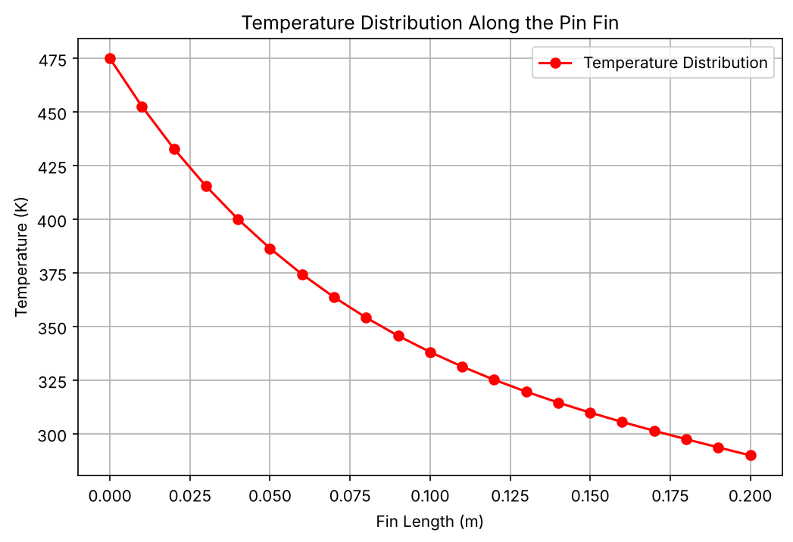

# Pin Fin Temperature Distribution (Finite Difference Method)

A Python solver for the steady-state temperature along a pin fin, written for a third-year mathematics project in Aerospace Engineering. It turns the fin equation into central differences and solves the resulting linear system with NumPy.



## Problem

A pin fin of length $L$ sticks out from a hot base into cooler surrounding air. Heat conducts along the fin and convects away from its surface. The goal is the temperature $T(x)$ along the fin.

Assumptions:

- Steady state
- One-dimensional conduction along the fin axis
- Constant thermal conductivity $k$ and convection coefficient $h$
- Uniform cross-section (constant perimeter $P$ and area $A_c$)
- Fixed temperatures at both ends: base at $T_0$, tip at $T_L$
- Radiation neglected

### Governing equation

$$
\frac{d^2T}{dx^2} - m^2\left(T - T_\infty\right) = 0, \qquad m^2 = \frac{hP}{kA_c}
$$

with boundary conditions $T(0) = T_0$ and $T(L) = T_L$.

### Parameters

| Symbol | Variable in code | Value | Units | Description |
| --- | --- | --- | --- | --- |
| $L$ | `L` | 0.2 | m | Fin length |
| $T_0$ | `T0` | 475 | K | Base temperature |
| $T_L$ | `TL` | 290 | K | Tip temperature |
| $T_\infty$ | `Ts` | 290 | K | Surrounding air temperature |
| $h$ | `hc` | 40 | W/m²·K | Convection coefficient |
| $P$ | `P` | 0.015 | m | Fin perimeter |
| $k$ | `k` | 240 | W/m·K | Thermal conductivity |
| $A_c$ | `Ac` | 1.55 × 10⁻⁵ | m² | Cross-sectional area |

These give $m^2 \approx 161\ \text{m}^{-2}$ and $mL \approx 2.54$.

## Method

The fin is split into $n = 20$ segments ($\Delta x = 0.01$ m, 21 nodes). Replacing the second derivative with a central difference at each interior node gives

$$
T_{i-1} - \left(2 + m^2\Delta x^2\right)T_i + T_{i+1} = -m^2\Delta x^2\,T_\infty, \qquad i = 1, \dots, n-1
$$

The known end temperatures move to the right-hand side of the first and last equations. That leaves a tridiagonal system of 19 equations, solved with `numpy.linalg.solve`. The boundary values are then added back to give the full profile.

## Results

The temperature falls from 475 K at the base to 290 K at the tip, dropping fastest near the base.

| x (m) | T (K) |
| --- | --- |
| 0.00 | 475.0 |
| 0.05 | 386.5 |
| 0.10 | 338.2 |
| 0.15 | 309.9 |
| 0.20 | 290.0 |

### Validation

With the tip held at the air temperature ($T_L = T_\infty$), this case has an exact solution:

$$
\frac{T(x) - T_\infty}{T_0 - T_\infty} = \frac{\sinh\big(m(L - x)\big)}{\sinh(mL)}
$$

Against it, the largest error at $n = 20$ is 0.039 K. The error drops about 4× each time $n$ doubles, which is the second-order convergence expected from central differences.

| Segments (n) | Max error (K) |
| --- | --- |
| 10 | 0.155 |
| 20 | 0.039 |
| 40 | 0.010 |
| 80 | 0.002 |

This check was run separately; the script itself doesn't include the comparison.

## Running it

```bash
pip install numpy matplotlib
python finite_distribution.py
```

The script shows the plot, then prints the temperature at each node.

## Author

Emils Jekabsons
